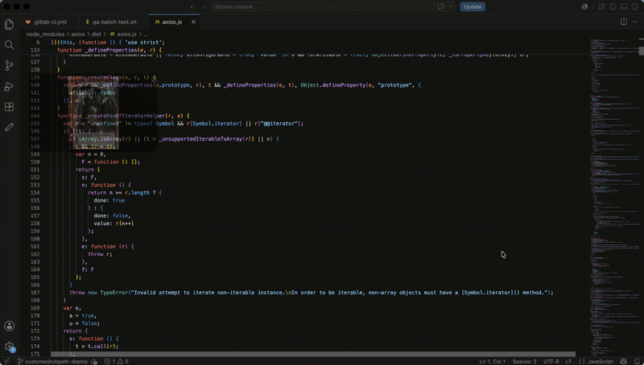

<p align="center">
  
</p>

<h1 align="center">FloatPane</h1>

<p align="center"><strong>透明浮层浏览器,支持 macOS、Windows 和 Linux。</strong></p>

<p align="center">
  <a href="./README.md">English</a> · <strong>简体中文</strong> · <a href="./README.ja.md">日本語</a>
</p>

<p align="center">
  <a href="https://github.com/Hpjxiangbabang/opabrow/blob/main/LICENSE"></a>
  
  
  
</p>

<p align="center">
  <a href="https://github.com/Hpjxiangbabang/opabrow/releases/latest"></a>
  <a href="https://hpjxiangbabang.github.io/opabrow/"></a>
</p>

<p align="center">上班摸鱼、随手查资料、盯住直播和看板，让想看的网页留在身边，而不是占满整个桌面。</p>

<p align="center">
  
</p>

## 为什么是 FloatPane

多数浏览器窗口会占据整个工作空间。FloatPane 是一款适合工作间隙和专注任务并行的“摸鱼浏览器”：参考资料、实时看板、播放列表、B 站视频，或任何你想在其他工作旁边保留的小任务。它安静地停在桌面边缘，不抢走你的工作区。

标题栏默认透明，鼠标移动到顶部边缘时才显示。它拥有独立的 32px 区域，因此显示控件时不会覆盖网页，也不会让页面发生位移。

| 保持安静 | 快速抵达 |
| --- | --- |
| 无边框透明窗口，标题栏悬停显示 | 地址栏、本地历史建议、前进、后退、刷新和主页 |
| 可调透明度与可选置顶 | 移动端 User-Agent 模式，用于检查响应式网页 |
| 本地优先的历史记录、收藏与密码，无账号或云端同步 | 原生 macOS 菜单命令与熟悉的快捷键 |

## 下载

前往 [最新发布版本](https://github.com/Hpjxiangbabang/opabrow/releases/latest) 下载 macOS、Windows 或 Linux 安装包。每个版本会提供：

- macOS Apple Silicon (`arm64`) 和 Intel (`x64`)
- Windows x64（`.exe` 安装器）
- Linux x64（`.AppImage`）

### macOS 安装

从下一版已签名的 macOS 发布包开始，应用会使用 Developer ID 签名，并通过 Apple 公证。打开下载的 DMG，将 **FloatPane** 拖入"应用程序"文件夹后即可正常启动，不需要输入任何终端命令。

当前 `v0.3.0` 的 macOS 安装包早于这套发布流程，会在已签名版本发布后替换。

## 快速开始

### 环境要求

- macOS
- Node.js 22 或更高版本
- pnpm（版本由 package.json 的 packageManager 字段固定，corepack 自动启用）

### 本地运行

```bash
git clone https://github.com/Hpjxiangbabang/opabrow.git
cd opabrow
pnpm install
pnpm dev
```

### 构建

```bash
pnpm build
pnpm build:mac
```

## 小巧但完整的浏览体验

### 地址栏与历史记录

将鼠标移动到窗口顶部，或按下 `Cmd+L`。静默时，地址栏只保留与 URL 文本等宽的紧凑点击区域，标题栏其余空间仍可用于拖动窗口。聚焦后才展开为输入框，并支持常规复制、剪切和粘贴快捷键。

输入时，FloatPane 会从本地导航历史中给出最多 5 条匹配建议。建议以页面标题在前、URL 在后的形式展示；使用方向键选择，再按 `Enter` 打开。

通过“历史 > 显示历史记录”或 `Cmd+Shift+Y`，可搜索、重新打开或清空最近浏览的页面；“历史”菜单也会保留最近 10 个页面，点击即可打开。FloatPane 最多只在本机保存 100 条历史记录，没有账号体系，也不会同步到云端。

默认主页是 FloatPane 项目仓库。在“浏览”菜单中选择“将当前页面设为主页”，即可将任意已访问页面设为本机主页；选择“恢复项目主页”可还原默认值。

### B 站视频页面

打开哔哩哔哩视频或番剧播放页时，播放器会自动切换到“网页全屏”。视频会填满可用网页区域，但始终保持在 FloatPane 窗口内。

### 查找、恢复与下载

按下 `Cmd+F` 可在当前网页内查找；`Cmd+G` 和 `Cmd+Shift+G` 可在匹配项之间前后切换，全程不离开浮层窗口。

重新打开 FloatPane 后，会恢复最后页面、窗口位置和尺寸、透明度、置顶状态及手机模式。下载文件会进入系统“下载”目录；通过“下载”菜单或 `Cmd+Shift+J` 可查看进度、失败状态，并在 Finder 中显示已完成文件。近期下载状态仅保存在这台 Mac。

窗口置顶时会默认开启点击穿透：鼠标点击和滚动会落到下方应用。需要操作浮层页面时，可在“视图 > 置顶时点击穿透”中关闭该特性。

### 收藏夹与浏览器导入

macOS 顶部“收藏”菜单提供收藏功能，不会占用浏览网页的空间。按下 `Cmd+D` 可收藏或取消收藏当前页面，并可从菜单的文件夹层级直接打开链接。支持从本机 Chrome、Safari 导入收藏，也可选择浏览器导出的标准 HTML 书签文件。收藏数据仅保存在本机的 FloatPane 应用数据目录。

### 从 Chrome 迁移密码与手动填充

可按自己的意愿迁移 Chrome 已保存的登录信息：先在 Chrome 密码管理器中导出密码 CSV，再在 FloatPane 的“密码 > 从 Chrome 密码 CSV 导入…”中选择文件。CSV 只有在你选中并确认警告后才会被读取；密码写入 FloatPane 本机应用数据前，会使用 macOS 钥匙串加密。FloatPane 不会读取 Chrome 内部密码库，不会把密码发送到服务器，也没有云端同步。

访问匹配的 HTTPS 网站时，选择“密码 > 填充当前页面”或按下 `Cmd+Shift+P`。页面加载时绝不会自动填充；同一网站有多个账号时，会先让你选择。Chrome 导出的原始 CSV 始终由你掌控，迁移完成后请自行删除它。

### 不抢占网页空间的窗口控件

关闭与最小化控件会在悬停时平滑出现。webview 始终从标题栏下方开始，因此显示控件时不会与网页内容重叠，也不会改变页面布局。

### 桌面与移动模式

从 macOS 菜单切换至移动端 User-Agent，即可检查网站的响应式体验；切回桌面模式时不会丢失当前页面。

## 键盘快捷键

| 快捷键 | 操作 |
| --- | --- |
| `Cmd+L` | 聚焦地址栏 |
| `Cmd+[` / `Cmd+]` | 后退 / 前进 |
| `Cmd+R` | 刷新 |
| `Cmd+Shift+H` | 打开主页 |
| `Cmd+T` | 切换置顶 |
| `Cmd+=` / `Cmd+-` | 调整窗口透明度 |
| `Cmd+K` | 打开命令面板 |
| `Cmd+D` | 收藏或取消收藏当前页面 |
| `Cmd+Shift+P` | 使用已保存密码填充当前页面 |

## 开发

```bash
pnpm typecheck
pnpm build
```

项目基于 Electron 和 React。Electron 主进程负责原生窗口与 macOS 菜单；渲染进程负责标题栏、地址栏、本地历史记录和 webview 交互。

## 路线图

免费核心专注于打磨浮层浏览体验。未来的 Pro 探索可能加入工作区、配置档案、可选同步和自动化，但不会移除本地优先的核心能力。

## 参与贡献

欢迎提交 Bug 报告、设计反馈和聚焦的 Pull Request。提交前请阅读 [CONTRIBUTING.md](CONTRIBUTING.md)。

## 二次开发新增能力

- **自定义安装目录**：Windows 安装包改用多步安装向导（`oneClick: false`），安装时可选择目标文件夹；macOS DMG 与 Linux AppImage 可直接放到任意位置。
- **显式主题切换**：视图菜单 / 托盘菜单 → 外观主题 → 浅色 / 深色 / 跟随系统。默认浅色，不再默认跟随系统；选择会持久化到 `session.json`，并同时作用于应用界面与网页的 `prefers-color-scheme`（通过 CDP `Emulation.setEmulatedMedia` 覆盖）。
- **防屏幕捕获**：视图菜单 / 托盘菜单 → 防止被截图 / 录屏 / 共享屏幕捕获。开启后调用 `BrowserWindow.setContentProtection(true)`，状态持久化。
  注意：无法阻止手机拍摄、外部采集卡或具备高权限的捕获工具；Linux 支持有限；部分远程桌面 / 虚拟显示环境下开启后窗口可能不可见。

- **统一数据目录（卸载无残留）**：`userData`、`sessionData`、缓存、Cookies、临时文件、崩溃转储、日志全部重定向到安装目录下的 `FloatPane-data/`，随安装地址一起移动；卸载程序通过 `build/installer.nsh` 删除该目录。视图菜单 / 托盘菜单 → 数据管理，可查看并打开数据目录、清除缓存与 Cookies。下载文件仍保存在系统下载目录（属于用户资产，不自动删除）。
- **透明度控件（v1.1.3）**：宽度足够时用拖动条；窗口收窄后自动切换为圆角三角步进器并显示当前百分比，箭头用内联 SVG 跟随深浅主题，不依赖外部图片素材。
- **标签页（v1.1.2）**：「标签」菜单与编辑 / 浏览 / 历史等同级，二级菜单列出全部已打开标签（可直接切换），分隔线下是「新建标签页 / 关闭当前标签页」。不设可见标签栏以保持浮层极简；标签列表重启后自动恢复。用户设置（主题、主页、历史、标签）统一保存在固定数据目录，升级安装不会丢失。
- **置顶交互（v1.1.1）**：置顶默认完全可交互，不再附带鼠标穿透；需要浮层参考时可在视图菜单 / 托盘菜单开启「鼠标移出窗口时自动穿透」，光标在窗口内可交互、移出窗口则事件落到下层应用。设计依据见 `TESTING.md`。
- **仅托盘模式**：视图菜单 / 托盘菜单 → 仅托盘模式。开启后窗口从任务栏隐藏，最小化与关闭都改为隐藏，只能单击托盘图标或使用托盘菜单「显示 / 隐藏」恢复；托盘菜单「退出」才是真正退出。状态持久化。

## 许可证

FloatPane 采用 [Mozilla Public License 2.0](LICENSE) 发布。
